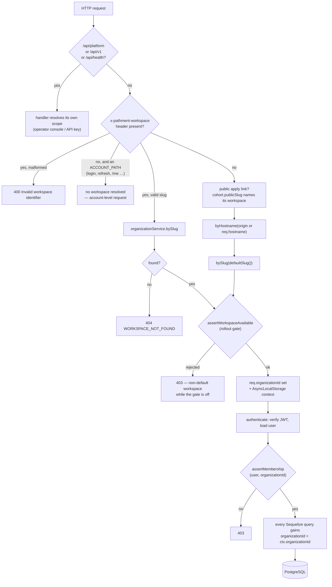

# Workspaces (multi-tenancy)

> Written because this is the most load-bearing and least documented boundary in the
> system. Everything below was traced from the source files named in it.

## What it is

One Pathment deployment serves many **workspaces** (organizations). A workspace owns its
programs, clans, people and content. Isolation is enforced in three places — HTTP,
Socket.IO, and the ORM — and gated behind a feature flag while the background workers
catch up.

## Why it exists

Pathment began as a single tenant (Dev Weekends). Workspaces were added so other
organizations could run their own programs on the same deployment, which means every
query written before that point had to become tenant-aware without being rewritten
one by one. Hence a scope installed over the ORM rather than a predicate per call site.

## Entry points

| Path | Role |
| --- | --- |
| `server/src/middlewares/organizationContext.js` | Resolves the workspace for an HTTP request, **before** authentication |
| `server/src/middlewares/auth.js:57` | Proves membership once the identity is known |
| `server/src/db/organizationScope.js` | Installs the Sequelize scope over every model |
| `server/src/services/organizationService.js` | `bySlug`, `byHostname`, `assertMembership`, `assertWorkspaceAvailable`, plans, limits, entitlements |
| `server/src/socket/index.js:51` | The same resolution for a WebSocket handshake |
| `server/src/utils/auditContext.js` | The `AsyncLocalStorage` the scope reads |
| `client-interface/proxy.ts` | Rewrites `/w/<slug>/…` to the route tree; handles legacy hosts |

## Execution flow



The resolution order is the part worth memorising: **header → public-link lookup →
origin hostname → default slug.** The fall-through to the default workspace is what
caused [the sign-up leak](../incidents/2026-11-15-signup-leaked-default-workspace-admin.md).

## How the ORM scope works

`installOrganizationScope(sequelize, models)` adds a predicate to every query:

- **Models with an `organizationId` column** get `organizationId = <context>`, using the
  physical column name so a scoped bulk `DELETE` still works after Sequelize has mapped
  attributes to columns.
- **Identity models without one** — `User`, `MentorProfile`, `MenteeProfile` — are scoped
  through a membership subquery against `organization_memberships` with status
  `active` or `suspended`. Authentication resolves the global identity first; directory
  and profile reads must then prove membership.
- **Nested `include`s are scoped recursively**, including association `through` tables.
  When the scope adds a `where` to an include it sets `required` deliberately, so adding
  a security predicate never silently converts a `LEFT JOIN` into an `INNER JOIN` (an
  admin need not have a mentee profile).
- **`skipOrganizationScope: true`** is the one documented escape hatch. It is greppable
  on purpose — every use should be obviously correct.

## Business rules and invariants

1. The workspace is resolved **before** authentication; authentication then proves
   membership. Selecting a workspace is not joining it.
2. `req.portal` and the workspace are different questions. See
   [decision 0005](../decisions/0005-portal-scope-travels-with-the-request.md).
3. `/api/platform` deliberately resolves **no** workspace — the operator console spans
   all of them and enters a target workspace's context on purpose.
4. `/api/v1` (public API) takes its workspace from the API key, never from a host or a
   default.
5. Socket rooms are workspace-scoped: `organization:<orgId>:user:<userId>`. An emission
   with no context is **dropped**, not broadcast.
6. When `MULTI_TENANT_WORKSPACES_ENABLED` is `true`, a workspace-owned query with no
   context throws `ForbiddenError` instead of running unscoped.

## Failure handling

| Condition | Result |
| --- | --- |
| Malformed workspace header | `400` `Invalid workspace identifier` |
| Named workspace not found | `404` `WORKSPACE_NOT_FOUND` |
| No default workspace initialised | `503` `WORKSPACE_NOT_INITIALIZED` |
| Non-default workspace while the gate is off | rejected by `assertWorkspaceAvailable` |
| Staging demo workspace, unsupported module | `403` `WORKSPACE_DEMO_RESTRICTED` |
| Membership revoked mid-session | the next socket event is refused; an idle socket is re-checked on a 60-second timer; `disconnectWorkspaceUser` drops them immediately when the mutation path calls it |

## Security concerns

- **Raw SQL bypasses the scope completely.** Queue claims, reapers and aggregates
  written in raw SQL must carry their own tenant predicate. This is the known gap.
- **Workers have no ambient context.** [TENANT_SOCKET_WORKER_AUDIT.md](../TENANT_SOCKET_WORKER_AUDIT.md)
  names the offenders by file: `notificationScheduler`, `certificateWorker`, both RAG
  workers, and `emailWorker` / `emailService`.
- Immediate socket revocation across several processes needs a shared Socket.IO
  adapter. The current in-memory adapter and presence are **process-local**, so the
  60-second re-check is the real guarantee, not the instant disconnect.
- The scope is a Sequelize-level guarantee. There is no Postgres row-level security
  behind it.

## Edge cases

- A public apply link shared before URLs carried `/w/<workspace>` arrives with no
  workspace; the cohort's `publicSlug` decides, not the default tenant.
- `/.well-known/` is served as itself on every host, or Android and iOS read the host
  as trusting no app and every email link opens the browser (`client-interface/proxy.ts`).
- Files under `/public` have no workspace; rewriting them broke the logo on the login
  page, so `isAsset()` exempts them.
- Account-level paths (login, refresh, `/me`, logout, 2FA, `/organizations`) accept no
  workspace, so a stale cookie cannot turn login into a redirect loop.

## Tests

```bash
cd server && npx jest tests/access --runInBand
cd server && npx jest tests/auth/signup-workspace-isolation.test.js --runInBand
```

Socket isolation runs without repository DB setup — the exact command is in
[TENANT_SOCKET_WORKER_AUDIT.md](../TENANT_SOCKET_WORKER_AUDIT.md#validation).
Client-side routing: `node --test client-interface/tests/handoff-routing.test.cjs`.

## Related

- Decision: [0003 — tenant scoping in the ORM](../decisions/0003-workspace-scoping-in-the-orm.md)
- Incident: [sign-up leaked a default-workspace admin](../incidents/2026-11-15-signup-leaked-default-workspace-admin.md)
- Audits: [tenant socket/worker](../TENANT_SOCKET_WORKER_AUDIT.md), [session handoff](../HANDOFF_SECURITY_AUDIT.md)
- Rollout: [WORKSPACE_PATH_ROLLOUT.md](../WORKSPACE_PATH_ROLLOUT.md)

## Unknowns

- Whether mixed-tenant rows already exist in production from before the guards. The
  audit says the HTTP/socket gate alone is insufficient if they do, and asks for the
  affected background execution to be paused through reviewed controls. **Unverified
  here** — this session did not access any production system.
- The audit asks for worker disable flags for email and RAG. **Those now exist** —
  `server/src/index.js:161` and `:174` read `EMAIL_WORKER_DISABLED` and
  `RAG_WORKERS_DISABLED`, added in the same commit as the audit (`7f549e02`), so that
  one line of the audit was already stale when it was written. Every worker listed in
  [MAP.md](../MAP.md#background-workers-started-in-serversrcindexjs-each-with-a-disable-flag)
  has a flag. A flag pauses a worker; it does not isolate data it already wrote.
